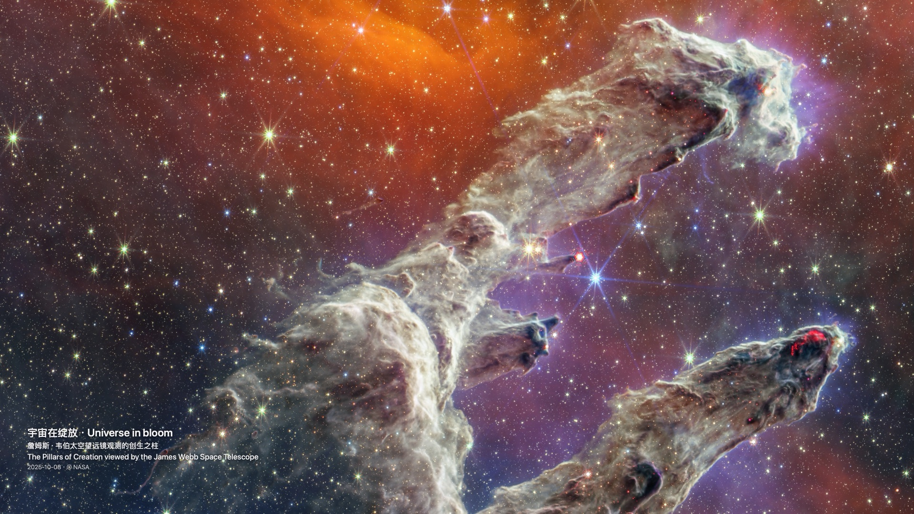

# bing-wallpaper-captions-mac

Collect the Bing image of the day on a Mac, and rotate through it on the
desktop with its description drawn on the picture, in Chinese and English:



<sub>Bing's image for 2025-10-08 as the desktop shows it, resized to
1920×1080. Image: NASA, ESA, CSA, STScI, J. DePasquale (STScI), A. Pagan
(STScI), A. M. Koekemoer (STScI), via
[ESA/Webb](https://esawebb.org/images/pillarsofcreation_composite/),
[CC BY 4.0](https://creativecommons.org/licenses/by/4.0/). Cropped by Bing;
caption added by this project.</sub>

- **`bing.sh`** downloads the UHD (3840×2160) images of the last 15 days into
  a collection folder in iCloud Drive. It skips dates it already has and never brings back an
  image you deleted. The title, description, credit, date and English text go
  into each file as XMP, without re-encoding.
- **`rotation.sh`** builds a separate folder with captioned copies of the 8
  newest and 8 random older images. macOS rotates through that folder. The
  originals are never changed.
- The caption sits bottom left, clear of desktop icons and the Dock. Its
  margin adapts to the narrowest screen the Mac uses, MacBook screens
  included.
- One Mac downloads; every Mac signed in to the same iCloud account shows the
  collection.

Not affiliated with Microsoft. Apart from the sample above, this repository
contains code only. See [Images and terms](#images-and-terms).

## Requirements

- macOS with `bash`, `curl`, `sed` and `plutil` (all built in).
- `swift` (Xcode Command Line Tools), required for downloads, XMP and captions:
  `xcode-select --install`. Downloads fail safely if XMP cannot be written.
- Collection operations use macOS ImageIO and exclusive rename; Linux downloads
  without XMP are no longer supported.

## Quick start

```sh
git clone https://github.com/lhc7970/bing-wallpaper-captions-mac.git
cd bing-wallpaper-captions-mac
./bing.sh          # originals  -> iCloud Drive/Bing_Wallpaper
./rotation.sh      # captioned  -> ~/Pictures/Bing_Wallpaper
```

Then in *System Settings → Wallpaper*, add the folder `~/Pictures/Bing_Wallpaper`,
turn on random order, and pick an interval.

The two folders share a name but not a role:

| Folder | Holds | Synced |
|--------|-------|--------|
| *iCloud Drive* › `Bing_Wallpaper` | the collection: originals, with XMP | yes, across your Macs |
| `~/Pictures/Bing_Wallpaper` | captioned copies for this Mac's desktop | no, each Mac builds its own |

## Settings

Every setting is optional. Put the ones you want in a config file:

```sh
mkdir -p ~/.config/bing-wallpaper-captions
cat > ~/.config/bing-wallpaper-captions/config <<'EOF'
# Keep the collection somewhere else, show fewer older images.
BING_WALLPAPER_DIR=~/Documents/Bing
BING_ROTATION_RANDOM=4
EOF
```

| Setting | Default | Used by |
|---------|---------|---------|
| `BING_WALLPAPER_DIR` | *iCloud Drive* › `Bing_Wallpaper` | both |
| `BING_ROTATION_DIR` | `~/Pictures/Bing_Wallpaper` | `rotation.sh` |
| `BING_ROTATION_RECENT` | `8` newest images | `rotation.sh` |
| `BING_ROTATION_RANDOM` | `8` random older images | `rotation.sh` |
| `BING_CAPTION_POSITION` | `bottom-left` (or `bottom-right`) | `rotation.sh` |

- **Precedence**, first match wins: command argument (the collection folder,
  for example `./bing.sh ~/Bing`) > environment variable > config file >
  default. An environment variable is handy for a one-off run, such as
  `BING_ROTATION_DIR=/tmp/test ./rotation.sh`.
- **Format:** one `KEY=value` per line. `#` starts a comment, quotes and a
  leading `~/` work, and unknown keys are reported. The file is read, not run
  as a script.
- **Location:** `BING_CONFIG` points to another config file.
- **No iCloud Drive** (for example on Linux): set `BING_WALLPAPER_DIR`, or the
  scripts stop with a hint.

## How it behaves

- **One image per date.** A date counts as present if any file starts with
  it: `YYYY-MM-DD ….jpg`, an iCloud conflict copy `… 2.jpg`, or a placeholder
  `.….jpg.icloud`. This also covers captions Bing edits after publishing.
- **Deleted images stay deleted.** `.bing-downloaded` in the collection folder
  lists the dates downloaded in the last 16 days. To get a deleted image back,
  remove its line while Bing still offers it.
- **New images wait for their English text.** Bing publishes a day's image in
  Chinese at 00:00 China time (16:00 UTC the day before), and the English text
  15 hours later. A new image whose English text is not out yet is left for a
  later run, for up to 24 hours; after that it is saved with Chinese text only.
  This is why the job below runs at 16:00 China time, with a second run at
  22:00 that catches a late day before the next image appears.
- **Missing English is filled in later.** While Bing still lists an image (15
  days), a later run adds English text that was not out when the image was
  saved. The match is by the image's own ID in its XMP (`bing:id`), never by
  date, so Chinese and English always describe the same picture. Pixels do not
  change. Images without XMP are left alone.
- **Downloads are atomic.** Images go to a temporary folder first, so iCloud
  never syncs a half-written file. Failed downloads leave nothing behind and
  are retried on the next run.
- **The rotation folder is generated.** Copies that are still wanted are kept,
  and are redrawn only when their original, the caption style or the screen
  changes. The random older images are picked once per day: every run on the
  same day keeps the same ones. Do not keep your own files in that folder.
- **System Settings may show missing thumbnails** for copies that were
  replaced while its Wallpaper pane stayed open; it appears to keep the list it
  read earlier. Quitting and reopening System Settings is the first thing to
  try.

Exit codes:

- `bing.sh`: `0` ok (including nothing new) · `1` no collection folder (no
  iCloud Drive and no setting), the folder cannot be read, the image list
  failed or has no images, or an image failed · `2` neither `plutil` nor `jq`
  is available.
- `rotation.sh`: `0` ok · `1` no collection folder, a folder cannot be read,
  there are no images, or a caption failed · `2` `swift` is missing.

The reasons behind these choices are in [docs/design.md](docs/design.md).

## Run daily with launchd

Save as `~/Library/LaunchAgents/local.bing-wallpapers.plist`, replacing the
paths:

```xml
<?xml version="1.0" encoding="UTF-8"?>
<!DOCTYPE plist PUBLIC "-//Apple//DTD PLIST 1.0//EN" "http://www.apple.com/DTDs/PropertyList-1.0.dtd">
<plist version="1.0">
<dict>
    <key>Label</key><string>local.bing-wallpapers</string>
    <key>ProgramArguments</key>
    <array>
        <string>/bin/bash</string>
        <string>-c</string>
        <string>status=0; "$1" || status=$?; "$2" || status=$?; exit "$status"</string>
        <string>local.bing-wallpapers</string>
        <string>/Users/YOU/bing-wallpaper-captions-mac/bing.sh</string>
        <string>/Users/YOU/bing-wallpaper-captions-mac/rotation.sh</string>
    </array>
    <key>StartCalendarInterval</key>
    <array>
        <dict><key>Hour</key><integer>16</integer><key>Minute</key><integer>0</integer></dict>
        <dict><key>Hour</key><integer>22</integer><key>Minute</key><integer>0</integer></dict>
    </array>
    <key>RunAtLoad</key><true/>
    <key>StandardOutPath</key><string>/tmp/bing-wallpapers.log</string>
    <key>StandardErrorPath</key><string>/tmp/bing-wallpapers.log</string>
</dict>
</plist>
```

The job runs the downloader and then rotates the available images, even if the
download fails. Its exit status is zero when both steps succeed. Otherwise it
returns the exit code of the last step that failed. Both scripts read the same
config file as when run by hand.

For an already loaded job, replace its `ProgramArguments` with the array above,
keeping your local script paths. Check the edited plist with
`plutil -lint ~/Library/LaunchAgents/local.bing-wallpapers.plist`, then run
the `bootout` command below followed by `bootstrap`. With `RunAtLoad` enabled,
the updated job runs immediately. Use
`launchctl print gui/$(id -u)/local.bing-wallpapers` to check the loaded
arguments and, after the run finishes, its last exit code.

```sh
launchctl bootstrap gui/$(id -u) ~/Library/LaunchAgents/local.bing-wallpapers.plist   # enable
launchctl kickstart gui/$(id -u)/local.bing-wallpapers                                # run now
launchctl bootout gui/$(id -u)/local.bing-wallpapers                                  # disable
```

The times are local: 16:00 and 22:00 suit China time (UTC+8). Elsewhere, pick
a first time after 07:00 UTC, when the English text is out, and a second one
before 16:00 UTC, when the next image appears. Extra runs are harmless: each
run only does what is still missing.

This is a user job. It runs at login, then at the times above while you are
logged in (also when the screen is locked). If the Mac was asleep, it runs
when the Mac wakes. It does not run while nobody is logged in.

### One Mac downloads, every Mac shows

Use the two-step job above on **one** Mac that is usually on. On every other
Mac that uses the same iCloud collection, run only `rotation.sh`, a bit later
(for example at 16:30 and 22:30), so iCloud has synced the new image first. Two Macs
downloading at once would create iCloud conflict copies.

### Permission

macOS privacy protection covers iCloud Drive, `~/Documents`, `~/Desktop` and
`~/Downloads`. Running the scripts by hand in Terminal works after Terminal's
one-time prompt. A launchd job runs as `/bin/bash`, which has no access there.
So with the default collection in iCloud Drive, the job needs the step below.
Without it, the log shows:

```
error: cannot read … (macOS privacy protection? see README, Permission)
```

To fix it, give `/bin/bash` Full Disk Access:

1. *System Settings → Privacy & Security → Full Disk Access*, then **+**.
2. Press ⇧⌘G, type `/bin/bash`, choose **Open**, and check that it is on.

This gives the access to every launchd job that runs `/bin/bash`, not only
this one. If that is not acceptable, run the scripts by hand, or keep the
collection outside the protected places (then it is not shared through
iCloud).

## Images and terms

The images belong to their photographers and agencies (see each caption's
credit), and are licensed to Microsoft for Bing. This project only downloads
them to your Mac for use as your wallpaper, as Bing's own wallpaper app does.
Do not redistribute the images. The only image in this repository is the
sample at the top, a Webb image released under CC BY 4.0; reusing it requires
its full credit line, shown with it.

The image list comes from an undocumented Bing endpoint, which Microsoft may
change at any time.

## Acknowledgements

- [timothymctim/Bing-wallpapers](https://github.com/timothymctim/Bing-wallpapers):
  the PowerShell script this project started from long ago. None of its code
  remains.
- [niumoo/bing-wallpaper](https://github.com/niumoo/bing-wallpaper): where the
  JSON endpoint with UHD images was found.

## License

[MIT No Attribution](LICENSE).


## Filename settings and archives

`BING_FILENAME_LANGUAGE=en|zh` (default `en`) selects the **description** language;
`BING_FILENAME_CREDIT=0|1` (default `0`) controls credit in the filename only.
Set these in the existing config file or environment (environment wins). Empty or
invalid values are errors. XMP and desktop credit text are independent of these
switches. English descriptions fall back to Chinese, then image ID, with a notice;
no translations are invented. Names retain `YYYY-MM-DD ` and `.jpg`; unsafe
characters are removed and names are bounded in UTF-8 length. Naming does not
rewrite XMP values. English backfill fills missing fields without overwriting
existing titles or automatically renaming files.

**Swift / Xcode Command Line Tools are now required for downloads.** A tag or
readback failure leaves no final image and does not record success, so a later run
can retry. The former download-without-XMP fallback (including Linux) is retired.

The collection includes its immediate `archive` or `Archived` directory (also
`Archive`/`archived`); other subdirectories are excluded. Archived photos participate
in date deduplication and rotation without being moved to the root. Duplicate dates
are reported and excluded from rotation/migration rather than guessed from numeric
suffixes. Symlinks and known offline/iCloud placeholder images are skipped. This
is not a recursive search through arbitrary folders.

Preview existing names (no image writes):

```sh
./rename.sh /path/to/collection
# Apply explicitly, retaining a NEW private JSONL recovery log outside the collection:
./rename.sh /path/to/collection --apply /absolute/new-recovery.jsonl
# Restore only files still matching the logged inode, size and modification time:
./rename.sh /path/to/collection --restore /absolute/new-recovery.jsonl
```

Migration stays in each image's current directory and changes paths only. Images
with incomplete XMP are left unchanged and reported. Destination conflicts are
skipped; exclusive rename never overwrites a destination. The log is written and
flushed before each rename, so interruption between rename and completion logging
can still be recovered. Keep the log until satisfied; restoration skips changed
or occupied paths and reports them. Exit 1 means at least one failure/skip requiring
attention; exit 2 means invalid usage/configuration. Ordinary metadata fallback
notices do not indicate a failed migration.

Only run migration on one Mac at a time. Download, rotation and apply/restore share
`.bing-operation.lock` in the collection. After a killed process, inspect the PID
and confirm no operation remains before manually removing that lock. A local lock
cannot fence another Mac's iCloud updates. A renamed library may change the day's
random selection; rotation rebuilds only selected copies. Failed rendering/moves
retain old copies and prevent cleanup. macOS may need to refresh the folder view.

Validation (macOS, no third-party packages):

```sh
swiftc bingkit.swift -o /tmp/bingkit-test
BINGKIT_TEST_BINARY=/tmp/bingkit-test python3 -m unittest discover -s tests -v
bash -n bing.sh rotation.sh config.sh rename.sh
```
